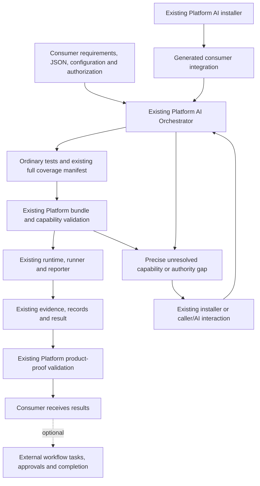

# Verification Plan Convergence — implementation specification

Status: revised architecture handoff, 2026-10-12. Documentation only; implementation has not started.

## 1. Objective and scope

Verification Platform is a self-sufficient, universal verification product. Any compatible consumer supplies high-level browser verification JSON conforming to Platform's published contract, explicit configuration and authorization. Platform's existing AI Orchestrator translates mandatory proof obligations into ordinary executable tests, establishes executable reconciliation using its compilation/coverage/capability validation, executes through its runtime, and returns its existing evidence and results.

Platform functionality depends only on its published contracts/capabilities/frontends/runtime, the consumer-specific integration generated by its AI installer under `.verification/integration/`, and consumer-supplied requirements, configuration and authorizations. The JSON producer may be an AI, a person or a development workflow. SpecKit, Solo Orchestrator, Feature Governance and Solo Governance are optional consumers; their artifacts, approvals, task interfaces and lifecycle are outside Platform's functional dependencies.

The completed solution guarantees:

- Every mandatory proof and required claim/environment pair survives compilation, execution and reconciliation, including blocked obligations.
- The AI Orchestrator reviews generated tests against original mandatory requirements, supported capabilities and evidence provenance. Faithful and complete decomposition is semantic AI judgment, not a deterministic guarantee of coverage or bundle validation.
- Full executable reconciliation requires both that semantic review and validated complete declared coverage, supported executable mappings, current bundle validation and no mandatory capability/prerequisite blockers. Neither an AI readiness declaration nor the proposed `fullyReconciled` output alone establishes both parts.
- Product proof additionally requires current reconciled evidence and verdicts. Executable reconciliation, setup readiness and a green runner are not product PASS.
- Precise gaps return through existing Platform technical-integration or caller/AI interaction mechanisms. Implementing a resolution resumes reconciliation until all mandatory obligations are executable, or another issue requires authority/action.
- A consumer workflow may use these outputs to update tasks, approve a feature or manage completion. Platform neither performs nor requires those workflow actions.

Mandatory implementation scope is Verification Platform and its AI-generated consumer integration. Reuse the existing JSON, tests, manifest, records, evidence, results and invocation. Introduce no additional Verification Execution Plan, action interpreter, engine, orchestration subsystem, tracking registry or duplicate proof infrastructure. The selected changes narrowly extend existing coverage/bundle validation and version matching in the existing readiness contract as described in section 4.1; no new schema or execution mechanism is introduced.

This specification does not authorize installation, product-code changes, live verification, consumer artifact/approval migration, or changes to Personalizer RM-02. MVP Complexity Controller is outside scope.

## 2. Source baseline and existing interfaces

The Platform checkout inspected is `/home/art/tools/verification-platform`, commit `a716bfac3bff`. Paths below are relative to this repository. Current implementation, rather than the earlier workflow-oriented design proposal, establishes the guarantees available today.

| Existing source/interface | Actual behavior and limits |
| --- | --- |
| [Contracts/types](../../src/contracts/index.ts), [integration contract](../../contracts/verification-integration.md) | Process-neutral `Plan`, `Assignment`, `Invocation`, `Manifest`, `Readiness`, `ClaimRecord`, `Evidence`, `Result` and `InvocationReturn`; serialized schema version 1. No SpecKit task IDs or approval-registry dependency. |
| [resolveResources](../../src/resources/resolve.ts) | Checks exact pinned index/resources and complete execution distribution. Explicit local root/index configuration; no latest/global-checkout/network fallback. |
| [validatePlan](../../src/validation/plan.ts) / `verification-validate` | Checks structure, IDs/references/prerequisites, binding and execution assignment/configuration identity. Planned configurations are allowed at planning; execution requires actual referenced files. Does not prove source fitness or operational readiness. |
| [validateCoverage](../../src/compilation/coverage.ts) | Requires exactly one entry per required pair, exact mandatory proof IDs, source/mode and declared capability/version mappings, and assignment/provider identities. Explicit blocked entries can validate successfully. |
| Same coverage implementation, capability mapping | Currently requires manifest capability IDs to exactly equal the plan's mandatory-proof capability annotations, although those annotations are optional in `Proof`. It rejects extra compiler-resolved operations. Section 4.1 permits such technical mappings in existing manifest fields while retaining every normative capability/version restriction. |
| [discoverProviders / validateBundle](../../src/compilation/bundle.ts) | Discovers configured exports/descriptors/declaration bytes; validates coverage, sources/identities, declared capability readiness/effects/imports and TypeScript compilation. Readiness checking requires matching supplied available status and nonempty evidence references; it does not independently observe prerequisites or validate those references' bytes. `valid: true` permits a partial bundle with blocked entries. No full-reconciliation output currently exists. |
| Same bundle implementation, capability checks | Current established support is checked by ID, while contract version is checked separately against any discovered descriptor. These checks do not necessarily establish support for the same exact version when descriptors contain different versions of one ID. Section 4.1 narrows this check. |
| Same bundle implementation, readiness matching | `Readiness` contains no capability version, and `validateBundle` matches it by ID/environment/status/evidence references only. Availability observed for version 1 can therefore satisfy a version 2 mapping; exact descriptor-version matching alone would not close this gap. |
| [capabilityReadiness](../../runtime/readiness.ts), [catalog](../../runtime/catalog.ts) | Availability derives from descriptor support and supplied evidence-backed prerequisites; indexed catalog includes source limits and unavailable dispositions. These helpers do not themselves observe all prerequisites or prove product behavior. |
| [invokePlaywright](../../runtime/invoke.ts), [VerificationReporter](../../runtime/reporter.ts), [EvidenceRecorder](../../runtime/evidence/records.ts) | Ordinary configured execution, real test annotation/source joins, flushed attempt/evidence records, zero-runnable blocked finalization and conservative crash handling. Invocation does not independently call `validateBundle`; frontend/generated entry must call it first. |
| [reconcile](../../runtime/evidence/reconcile.ts) | Shared mandatory-evidence reconciliation with per-pair and aggregate verdicts; accepted sources/providers, windows, attachment integrity and runner collection. Does not establish capability callability or semantic correctness of the generated assertions. |
| [validateResult](../../src/validation/result.ts) / `verification-validate-result` | Rechecks current plan/binding/assignment/source/provider/fixture bytes and exact equality with shared proof reconciliation. `valid: true` requires current aggregate PASS. It does not call bundle/capability validation. |
| [AI Orchestrator](../../frontends/verification-orchestrator/SKILL.md), [installation/adoption entry](../../frontends/verification-orchestrator/assets/installation-adoption.md) | Existing AI translation and installer-owned regeneration/adaptation/HITL procedures. Product execution receives explicit neutral input, not a native Feature selector. The frontend currently instructs coverage/typechecking but does not expose a deterministic full-reconciliation decision. |

Public package interfaces are already exported by `package.json`: `@verification-platform/support/validation`, `/compilation`, `/runtime`, `/invocation`, `/result-validation`, `/reporter`, `/resources` and `/contracts`. The existing `/compilation` entry exports `discoverProviders` and `validateBundle`; it does not export `validateCoverage` directly. Reuse the coverage validation already invoked inside `validateBundle`, rather than adding another public validator or consumer copy.

The [older SpecKit integration design](verification-platform-speckit-integration.md) describes an optional process adapter and historical insertion points. It does not impose workflow dependencies on this universal solution. The previously inspected Solo/Governance implementations are relevant only to the optional integrations in section 4.3.

## 3. Final architecture and ownership



| Owner | Responsibility |
| --- | --- |
| Consumer/caller | Supply the authoritative high-level JSON, expected behavior, mandatory proofs/accepted sources, required environments, configuration and permissions. Decide legitimate changes of requirements or proof method. No particular development workflow is required. |
| Platform AI Orchestrator/compiler | Independently validate explicit inputs, discover configured capability support, translate obligations into ordinary tests and full existing coverage, check translation/source fitness, call Platform bundle validation, execute permitted runnable work and return precise gaps/results. |
| Platform compilation library | Own the deterministic mechanical full-reconciliation criterion, coverage validation and supported executable mapping/type/source checks. Generated consumer code calls it; it does not define a separate criterion. |
| Platform AI installer | Derive technical adaptation from Platform requirements and current native consumer sources. Regenerate installer-owned integration and resolve authorized technical incompatibilities through existing installation/integration procedures. |
| Generated consumer integration | Supply fixtures, provider declarations/exports, adapters, compatible loader/typechecking/runner configuration, optional project readiness hook and execution/evidence wiring. It adapts technical interfaces; it owns no verification requirements, permission grants or workflow decisions. |
| Platform runtime/evidence mechanisms | Execute the supported topology and typed operations, preflight, record/collect evidence and reconcile product proof using existing contracts. No feature/task/approval interpretation. |
| Optional external workflow | Produce requirements or consume Platform results to update tasks, apply its own approval rules and manage completion. These are downstream actions, not Platform acceptance conditions. |

Platform defines WHAT integration must satisfy; its AI installer determines HOW from current native consumer code/configuration. All integration-only code remains installer-owned under `.verification/integration/`, confined by realpath. Previous generated integration is not requirement authority. On install/upgrade/recovery, regenerate through existing mechanisms, preserving native semantics, permissions, active attempts and retained evidence. Do not modify indexed Platform bytes inside a consumer installation.

Normative consumer proof JSON and requirements remain caller-owned outside generated integration. A setup-only plan/probe generated for the existing installation mechanism does not replace the consumer's product-proof obligations. Provider declarations can bind technical exports, but cannot create or waive acceptance requirements.

### Separate outcomes

1. **Executable reconciliation:** every mandatory obligation has a validated supported executable mapping, current prerequisites and no blocker. This permits verification; it does not prove the product.
2. **Actual product proof:** existing claim records/evidence and shared reconciliation establish PASS, FAIL, BLOCKED or INCONCLUSIVE in the assigned environment.
3. **Consumer workflow completion:** a consumer may apply additional task, approval or acceptance rules to those outputs. Platform does not decide or require this outcome.

Development-design readiness remains a consumer concern: planned support can be designed/tasked before exports exist. Installation/adoption readiness and ENVIRONMENT READY remain Platform's existing setup outcomes. None establishes complete executable reconciliation or product proof by itself.

Universality means independence from development processes. The currently supported execution topology remains WSL Node/Playwright → Windows headed Chrome/PowerShell/UIA; this solution adds no other host topology.

## 4. Required implementation changes

### 4.1 Mandatory Verification Platform changes

| Exact existing file/function/section | Change and reason |
| --- | --- |
| `src/compilation/coverage.ts`, `validateCoverage` capability checks | Require every capability annotated on a mandatory proof to remain in the pair's manifest entry at its specified version. Permit additional compiler-selected capability IDs/versions in the existing fields for technical translation; require a version for every listed ID. Preserve exact mandatory proof IDs, source/mode, complete pair coverage and identity checks. Additional operations must pass existing bundle support/readiness/effect validation; they cannot replace consumer-pinned operations or weaken proof. |
| `src/compilation/bundle.ts`, `validateBundle` return paths | Add `fullyReconciled: boolean` to the existing transient function return alongside `valid`, `diagnostics` and existing `validation` where present. Compute only the mechanical declared-mapping criterion in section 5.5; the name does not imply semantic decomposition completeness. Preserve partial `valid`, set the new field false on every invalid return, and do not accept a thrown error as success. |
| Same function, runnable-entry capability/readiness checks | Require an established capability with both the declared ID and exact declared contract version. Use existing `validateSchema('readiness', ...)` before accepting a readiness row; match capability ID, `capabilityVersion`, environment, available status and nonempty evidence references to the manifest's version. Versionless or mismatched readiness cannot establish availability. Preserve existing effect, identity, discovery and typechecking checks and diagnostics. |
| `src/contracts/index.ts`, `Readiness`; `distribution/schema-source.mjs`, readiness definition; generated `schemas/readiness.schema.json` | Add `capabilityVersion?: string` to this existing record/schema, using the existing nonblank string rule. Keep it optional for structural compatibility with versionless legacy records, but mandatory for accepting available readiness at bundle validation. This supplies the missing join key without a new schema, artifact or sidecar. |
| `runtime/readiness.ts`, `capabilityReadiness` | Emit each descriptor's actual `contractVersion` as `capabilityVersion`. Generated integration must collect prerequisites for that exact version and current configured source/environment; do not relabel observations from another version. |
| `frontends/verification-orchestrator/SKILL.md`, Execution | Teach the process-neutral flow and requirement-first decomposition audit in section 5.1. Invoke `validateBundle` explicitly before shared execution, but report complete reconciliation only with both mechanical success and the semantic audit. Preserve blockers, distinguish partial work and return gaps through Platform/caller mechanisms. No Feature scanning, governance import or task/approval mutation. |
| Same file, result return and gap handling | Return existing `InvocationReturn`, manifest/result/evidence paths and original runner/acceptance exits. Continue affected reconciliation after technical or human-authorized resolution; retain actual proof verdicts independently of executable readiness. |
| `contracts/verification-integration.md` | State universal explicit-input operation, consumer requirement authority, generated integration's technical-only ownership, full-reconciliation criterion and continuation. SpecKit/Solo are optional producers/consumers, not mandatory authorities. |
| `contracts/contracts.md`, compilation/result boundaries | Document compiler-selected operations with retained normative pins, the transient mechanical `fullyReconciled` output, unchanged partial `valid` meaning, version-matched readiness and semantic/product-proof limits. Keep existing serialized format versions; versionless readiness remains readable but cannot grant current availability. Producers/consumers use one matching pinned release. |
| `frontends/verification-orchestrator/assets/installation-adoption.md`, CONFIGURE CONSUMER and integration ownership instructions | Require the existing generated product-execution wiring to call public Platform validation/invocation/result APIs independently of workflow tooling. Keep setup-only readiness probes, installation HITL/checkpoints and product proof separate. Do not execute product test bodies during adoption readiness. |
| `tests/runtime/bundle.test.mjs` | Extend real bundle fixtures for valid/blocked/invalid mappings and exact-version support/readiness. Version 1 or versionless readiness cannot enable a version 2 mapping; matching version 2 readiness can. A technically valid source omitting a required semantic operation may still set `fullyReconciled: true`; retain this limitation rather than testing a nonexistent semantic validator. |
| `tests/runtime/catalog.test.mjs`, existing readiness helper checks | Verify `capabilityReadiness` emits the descriptor's contract version; update direct bundle readiness fixtures to supply the observed version. Existing schema validation remains in use. |
| `tests/runtime/compilation.test.mjs` | Cover compiler-selected additional operations, including plans with unannotated proofs, using the existing manifest fields; dropping/changing normative capability pins and mandatory proofs still fails. Reuse/extend blocked coverage and zero-runnable finalization fixtures for independent operation and continuation after a corrected supported mapping. Use actual existing APIs, not a mock workflow engine. |

The additive boolean is an output of the existing compilation API, not a new persisted plan, result schema, validator, readiness state or tracking artifact. `package.json` and `src/resources/inventory.ts` already publish/index this compilation module; use the normal build/declaration/release mechanism. No new package export or index resource is needed.

Keep `src/validation/plan.ts`, `src/validation/result.ts`, `runtime/invoke.ts`, `runtime/reporter.ts`, `runtime/evidence/reconcile.ts` and all serialized schemas except the existing readiness definition unchanged. Only `Readiness` in the shared types changes. Their existing APIs are composed, not replaced. No new executor or repair loop belongs in the runtime.

### 4.2 Mandatory generated consumer integration

The existing installer chooses actual consumer filenames and module/loader adaptation under `.verification/integration/`. There is no universal consumer file template or additional configuration artifact to mandate. Realize these requirements in its existing generated execution entry, fixture and runner:

- Compose the shared fixture with ordinary `test.extend`; expose the actual configured `test`, `expect` and permitted APIs/providers. Product proof depends on the existing `assignedPage`/preflight boundary.
- Accept the existing explicit `Invocation`, local `ResolutionConfig` and configured execution inputs. Call `discoverProviders`/`validateBundle` from `/compilation`, then `invokePlaywright` from `/invocation` when valid runnable work is authorized. Consume Platform's full-reconciliation output without redefining it.
- Supply current readiness evidence for the exact mapped capability contract version, TypeScript configuration/compiler entry, full manifest and source/fixture/provider identities. Legacy versionless readiness must be re-established for the selected version, not upgraded by inference or relabeling. Adapt technical incompatibilities without changing mandatory proof or advertising unavailable operations.
- Preserve existing records, evidence envelopes/raw attachments, reporter joins and result paths. Call `validateResult` from `/result-validation` for full current product-proof validation; use `reconcile` from `/runtime` only for existing shared per-pair proof reconciliation.
- Expose actual validation outputs through normal tool/caller output and return existing `InvocationReturn` paths/status/diagnostics. No new reconciliation file, registry or task state is required.

If current integration already supplies some of this wiring, reuse it; regenerate/adapt missing wiring through the existing authorized installer. Requirements and authorization come from the caller. Do not ask the consumer to install SpecKit/Solo or handwrite a second verifier to make Platform operational.

### 4.3 Optional downstream integration improvements

None of the following changes is required for Platform operation, full reconciliation or acceptance:

| Optional consumer repository | Existing extension points it may improve |
| --- | --- |
| `speckit-feature-governance` | `extension/docs/verification-integration.md`, existing Plan/Tasks/Analyze addenda and Guard may teach production of the Platform JSON and trace results to existing task obligations. |
| `speckit-solo-orchestrator` | `Repository.verification_handoff(assignment)` in `extension/scripts/solo.py` and the existing Implement prepend may dispatch ordinary Platform invocations and consume results. Any CLI wrapper is a downstream interface choice, not a required Platform component. |
| `speckit-solo-governance` | Existing completion command and `verify_completion` may consume full reconciliation/product-proof outputs before applying their own lifecycle/Human Acceptance rules. |
| Any other consumer workflow | May map claim/environment verdicts to its own task or approval system using existing result IDs/evidence. No prescribed registry or workflow stage. |

Keep workflow-specific context, fingerprinting, approvals, evidence publication rules and task mutations inside these optional adapters. Platform neither imports their Python/commands nor reads `.specify`, ROADMAP or approval registries. No change to MVP Complexity Controller is selected.

## 5. Execution and reconciliation rules

### 5.1 Consumer input and obligation-to-test translation

Use the consumer's explicitly supplied JSON conforming to `schemas/browser-verification-plan.schema.json`. `browser-verification-plan.json` is the existing filename convention; `Invocation.planPath` is explicit and no Feature directory or producer is required. The schema contains sources, expected behavior, mandatory proofs/accepted sources, environments, prerequisites, mode, effects, timing and configuration/support dispositions. No action language, permission booleans or mutable outcomes enter it.

For every required claim/environment pair, Platform's AI Orchestrator must:

1. Read every mandatory proof and its accepted source/provider combinations. Identify required stimuli, observations, assertion boundaries, identity/timing requirements and any explicit human contribution from the consumer's obligations.
2. Inspect pinned indexed `contracts/generic-descriptors.json`, `contracts/unavailable-capabilities.json`, actual configured providers/declarations and fixture exports. Match the precise operation/source and its limits. Similar names, code existence or types alone do not establish fitness.
3. Use supported generic operations when sufficient. Use separately authorized consumer providers for genuine project observation/control at the real boundary, preserving provenance/effects. Missing generic UIA/CDP functionality does not authorize product instrumentation.
4. Preserve consumer-pinned `Proof.capabilityId`/`capabilityVersion` and accepted sources. Resolve additional necessary technical operations into existing `CoverageEntry.capabilityIds`/`capabilityVersions`, using the coverage change in section 4.1; this does not edit the normative JSON or require a workflow decision. The schema makes proof capability annotations optional, so the compiler must identify all required operations rather than rely on annotations alone. An unsupported or unrepresented required operation retains a blocker; it cannot silently disappear to pass validation. Ordinary assertions need no invented descriptor. Changes to normative restrictions, accepted sources or proof method remain the caller's decision.
5. Generate ordinary `.spec.ts` using the exact configured fixture's `test`/`expect`, typed APIs, `test.step`, assertions and real `testKey` annotations. Flush attempts before relevant effects, capture all mandatory evidence/decisive contradictions through `EvidenceRecorder`, and complete proof records only after required assertions/evidence.
6. Retain unsupported pairs and all mandatory/source/capability references in the existing manifest with `CoverageEntry.blocker`. No passing placeholder, silent skip, optionalization, unauthorized proof-method substitution or readiness-based product PASS.

The compiler owns translation/source-fitness review. After generation, audit from each original mandatory proof and its governing source into the actual test code, rather than starting from the generated manifest. Account for every required stimulus/setup, observation/source, assertion, causal/order/timing boundary and human contribution. Reference the relevant proof IDs and real source/step/assertion locations through existing manifest `steps`/`assertions` strings and normal frontend explanation. A missing necessary operation requires code/mapping correction or an existing blocker; uncertain normative meaning returns to the caller. Re-audit affected proof when requirements, generated source or relevant provider semantics change. No new review artifact, approval flag or validator is required.

This audit supplies semantic assurance, not a deterministic completeness proof. `validateCoverage` checks proof IDs and nonempty mapping labels; `validateBundle` checks imports/types and declared capability support, not that each necessary call occurs. A test can retain every proof ID and capability annotation yet omit the required stimulus or use an unrelated assertion, and still satisfy the proposed `fullyReconciled` predicate. The existing AI instructions warn that typing is insufficient but do not themselves enforce a requirement-by-requirement audit. The correction strengthens that existing AI review; it does not claim to make semantic judgment infallible. No governance product is needed.

Capabilities grant no permission. Each operation must fit the claim's effects and the assignment's restrictions, prerequisites and environment/source limits. In the inspected catalog, `native:menu` is established with documented limits, `native:semantic` is unestablished and `chrome:worker-interruption` is unavailable. Related helpers do not establish arbitrary native gestures or worker lifetime proof. Use the exact pinned distribution and current readiness.

Assisted/human modes retain the consumer-approved human contribution and accepted evidence provenance through configured provider/fixture collection and ordinary claim records. Missing real contribution/wiring remains blocked or unresolved. A human authorization decision is not product proof, and an automated obligation cannot become human proof as a local fallback.

### 5.2 Explicit invocation and authorization

The consumer or Platform AI frontend constructs the existing neutral invocation directly:

```text
Invocation = {schemaVersion: 1, planPath, planDigest, binding, assignment}
resolution = {root, indexPath, mode: 'execution'}
```

Use `resolveResources` and `validatePlan` to obtain/check current plan/binding identities against the complete pinned distribution. The consumer supplies `Assignment.authorization.reference`, exact plan/binding digests, allowed effects, environments/builds/runtime selection, fixture/runner/providers, ownership, evidence constraints and output root. Platform validates those contract relationships; a reference does not itself create permission.

Before using concrete browser/version/profile/site/account selection, follow the existing Platform explicit-selection approval rule and reuse approval only for the exact selection. Discover technical values autonomously where possible. Missing authority/action uses existing caller/AI interaction; no Solo approval record is required.

`.verification/platform.json` remains the consumer's immutable release/resource selection, not an execution configuration or approval registry. Local distribution resolution is configuration. Planned support/configuration can be validated in planning mode independently of execution; actual execution requires realized referenced files and callable support. Delivery alone does not require rewriting normative `disposition: planned` to report progress.

### 5.3 Existing compilation and execution flow

```text
consumer Invocation + explicit resolution/configuration
  → validatePlan(execution inputs)
  → discoverProviders(current configured modules)
  → generated ordinary tests + full existing Manifest, including blockers
  → validateBundle(current sources, TypeScript configuration and readiness)
  → authorized invokePlaywright for valid runnable entries
  → existing reporter, records, evidence and Result
  → validateResult(current complete proof inputs)
  → caller receives existing outputs
```

The AI Orchestrator drives this flow through its existing frontend and generated technical entry. No workflow handoff is mandatory. Keep explicit invocation/attempt identities and normal tools; do not introduce a persistent verification workflow or a runtime agent dispatcher.

A bundle with `valid: true`, `fullyReconciled: false` may run independent supported entries with blocked obligations retained. Invalid bundles cannot execute as validated proof. A zero-runnable bundle uses the existing blocked finalization path; it never creates a successful placeholder test. Full reconciliation cannot be claimed until section 5.5 succeeds.

Shared Chrome/native desktop execution keeps one worker, no full parallelism, zero retries and exclusive assignment. Preflight remains BrowserPreflight → optional ProjectPreflightHook → TargetPreflight → ENVIRONMENT READY. A blocked gate produces proof NOT RUN and unattempted blocked records. Hooks are observation-only; authorized setup/remediation occurs outside them.

Preserve all observable browser state after ordinary proof/test execution. Browser cleanup/reset remains an explicitly authorized lifecycle action; temporary verifier connection cleanup follows existing ownership. Do not install providers, transparently replace identities or replay uncertain actions during an atomic proof.

### 5.4 Evidence, product proof and optional workflow consumption

Use the existing reporter/invocation-collected records and attachments, not a reconstructed directory scan to assert success after a crash. Actual annotation/source joins and current identity are required; the crash path's `incomplete-collection` cannot accept PASS.

Full current product-proof validation is the existing `validateResult` API or exact matching CLI with:

```text
{planBytes, binding, resolution, projectRoot, assignment,
 manifest, result, evidence, records, outputRoot, sourceRoot}
```

It checks current bytes/identities and exact equality with shared mandatory-evidence reconciliation. `valid: true`, `verdict: PASS` means aggregate current proof under the declared assertions/evidence mapping; fidelity to the original requirements still depends on section 5.1's semantic review. The reconciler joins assertion/proof labels and evidence provenance/integrity, not the meaning of assertion code or raw facts. It does not check bundle callability/readiness, so executable reconciliation must be established separately. A non-PASS aggregate does not imply every pair failed; `Result.claims` retains per-pair verdicts.

Preserve full manifest/result and records/envelopes/raw attachments with valid source/output roots and attachment paths/digests. Keep generated sources available for current result validation. Publication to project-relative acceptance inputs or a feature evidence file is an optional consumer policy; Platform does not require a Feature, task file or Human Acceptance registry.

Use the existing `InvocationReturn` fields: generation-only full reconciliation can report `generated`; unresolved generation/capability blockers report `generation-blocked` with actual paths/diagnostics. An executed attempt reports `complete` with its real result, which may be non-PASS or only partially executable. Status `complete` means the attempt returned, not full reconciliation, product success or workflow completion. Preserve `runnerExitCode` and `acceptanceExitCode` separately.

An optional workflow may select whole claim/environment pairs from current validated `Result.claims` to satisfy its own tasks. A pair's PASS already requires all its mandatory proofs; partial proof is not a passing claim. Such task allocation, checkbox mutation and lifecycle approval remain outside Platform.

### 5.5 Exact reconciliation conditions

Let the required pair set be every `(claim.id, environmentId)` in the current plan. Each pair's mandatory proof set is the claim's `proof` entries with `mandatory: true`.

| Assertion | Required existing proof surface |
| --- | --- |
| Coverage is complete | Existing `validateCoverage`, invoked within `validateBundle`, returns no errors for the full pair set, exact mandatory proof/source/mode references, retained normative capability/version pins and versioned compiler-selected operations, plus assignment/provider identities. Blocked entries remain present. |
| Declared mappings are mechanically executable | Current bundle validation checks mapping labels, supported exact-version exports, supplied version-matched availability/evidence references, effects and source/fixture/provider/type identities; no declared blocker remains. It does not prove that all necessary operations are represented or used. |
| Complete executable reconciliation can be reported | Mechanical `fullyReconciled: true` plus section 5.1's requirement-first semantic audit, with no detected omissions or unresolved mandatory gaps. This combines deterministic declared-mapping validity with AI judgment of decomposition completeness; neither alone proves both. |
| Actual product proof | Existing `reconcile` produces per-pair verdicts; `validateResult` establishes current aggregate PASS under the declared assertion/evidence mapping. Fidelity to original requirements retains the semantic review in sections 5.1 and 5.4. |
| Consumer workflow completion | The external consumer applies its own rules to Platform outputs; no Platform functionality or acceptance depends on this decision. |

Implement the mechanical criterion inside the existing `validateBundle` after all current checks and the exact-version support correction in section 4.1:

```text
valid = diagnostics.length === 0
fullyReconciled = valid && manifest.entries.every(entry => entry.blocker === undefined)
```

Here `valid` includes full current plan/resource validation, `validateCoverage` success, exact source/provider/fixture/assignment identities, declared capability/readiness/effect checks and actual typechecking, with section 4.1's corrections. With no blocked entries, those checks apply to every declared pair. All early invalid returns have `fullyReconciled: false`. The output is recomputed for current inputs and certifies only the declared mapping. Readiness must match `(capabilityId, capabilityVersion, environmentId)`; availability facts come from bounded current observations/providers, not from the version label itself.

The inspected implementation currently returns only partial-bundle `valid`; it can succeed with mandatory blockers. The proposed boolean additionally excludes declared blockers but cannot detect an omitted necessary operation. Even a later product PASS cannot automatically repair that semantic omission, because generated assertions/records may carry the expected labels while testing the wrong property. Full reconciliation reporting therefore requires the audit, with its AI-judgment limit made explicit. `validateResult` does not replace bundle/capability validation.

The readiness correction deterministically prevents a supplied version 1 or versionless availability record from satisfying a version 2 mapping. It does not validate the truth, freshness or version provenance of arbitrarily relabeled evidence; producers must actually establish readiness for the selected descriptor/current source and environment. Use the additive field within the existing readiness schema/record and matching pinned release. Old records remain structurally readable but require re-establishment before current execution, rather than a new schema, registry or version sidecar.

Existing verdict precedence remains FAIL → BLOCKED → INCONCLUSIVE → PASS. An unsupported prerequisite before attempt is BLOCKED; a supported method contradicting requirements is FAIL; missing/stale/lost evidence after attempt is INCONCLUSIVE. Preserve decisive contradictions and actual runner status. Full executable reconciliation can precede a failing product test; successful setup alone cannot establish product proof.

Plan/binding/final assignment, generated source, fixture/provider entry/declarations and relevant environment/readiness changes require affected revalidation. Reuse evidence only where existing validation/reconciliation accepts its exact identity and scope; do not union mismatched attempts to manufacture PASS. No separate freshness or reuse ledger is introduced.

### 5.6 Capability-gap handling and continuation

Return a precise ordinary diagnostic for each unresolved mandatory operation:

- Claim ID, proof ID(s), environment and governing source.
- Required stimulus/observation/property and why actual available sources cannot establish it.
- Expected capability/version if known, configured export/provider, support/readiness disposition, limits/errors and evidence paths.
- Whether the issue is authorized technical integration, environment/permission/external action, Platform capability or a normative consumer decision; identify its owner and concrete next action.

Use existing `CoverageEntry.blocker`, record reasons, result limitations, `InvocationReturn.diagnostics` and normal caller/AI interaction. No new blocker artifact, schema or tracking system is required.

| Gap | Platform-owned handling and existing return route |
| --- | --- |
| Missing/incompatible generated integration within authorized native semantics | Platform AI installer regenerates/adapts under `.verification/integration/` through its existing procedures. Discover/derive technical values and validate the correction. Do not replace code used by a running attempt or reinterpret consumer requirements. |
| Missing environment, selection/effect authorization or owner-exclusive action | Platform AI frontend presents the exact needed decision/action through its existing caller interaction. Wait for actual authorization/completion and validate resulting state before a fresh affected attempt. |
| Unsupported generic operation/source | Platform identifies its exact capability limit and retains mandatory blocked coverage. Existing integration adaptation may bind an already supported operation only if it preserves the required proof. A genuinely absent Platform capability requires separately authorized Platform work/release; do not fabricate support or compensate with unauthorized product instrumentation. |
| Genuine consumer internal source absent | Ask the consumer's authority for the smallest permitted provider/source/effects design or external delivery. Generated integration can adapt/bind authorized existing sources; it cannot create new product instrumentation under integration-only authorization. |
| Required behavior/proof/architecture decision must change | Return the precise question to the caller/requirements owner through existing AI interaction. The consumer may use governance tools, but none is mandatory. Revalidate legitimately revised JSON/configuration/authorization; never waive obligations locally. |
| Product test contradicts a defined requirement | Preserve FAIL/evidence and return to the consumer for authorized product correction. Product implementation and workflow task management are outside Platform's convergence changes. |

During installation/adoption, reuse `requestAdoptionHITL`, `resolveAdoptionHITL`, `adoptionResumeAction` and existing checkpoint/decision rules. Their cancellation option cancels installation, not mandatory product proof. During product verification, use the existing execution frontend's caller interaction and claim/evidence/attempt outputs; do not repurpose adoption checkpoints as a new verification state machine.

Implementing an approved gap resolution resumes reconciliation; it does not complete it. Revalidate affected inputs/readiness, regenerate/recompile affected tests as necessary, and call existing bundle validation again. Continue through the same Platform AI frontend, installer/integration and caller mechanisms until section 5.5 establishes all mandatory obligations executable, or another unresolved issue requires human authority/action. After that resolution is implemented, resume the same reassessment. Then execute/validate actual proof as requested; executable completion does not claim product PASS.

A corrected realization or legitimately changed input creates a fresh recorded affected attempt; it does not authorize unchanged retries or side-effect replay. Preserve unaffected valid evidence and historical results. While a required human/external action is pending, report/retain the precise blocker and wait. No specific governance repository, workflow stage or new orchestration mechanism is required.

## 6. Acceptance criteria for the implementation

Use focused deterministic Platform fixtures and disposable consumer integration for mechanism validation. Synthetic evidence does not establish real capability support or consumer product proof. This documentation task runs no implementation or browser tests.

| Criterion | Objective evidence |
| --- | --- |
| Workflow-independent operation | A disposable compatible consumer with no `.specify`, ROADMAP, `tasks.md`, Solo or governance installations supplies ordinary plan/assignment/invocation. Existing Platform validation/compilation/invocation/result interfaces operate on it without process-state lookup. Reuse `tests/fixtures/current-result.mjs` and bundle/ordinary execution fixtures. |
| Deterministic declared-mapping validation | Existing bundle fixtures show supported declared coverage gives `valid: true, fullyReconciled: true`, blocked coverage gives `valid: true, fullyReconciled: false`, and invalid mapping gives both false. This tests the mechanical predicate, not complete semantic decomposition. |
| Decomposition completeness review | The frontend audits every original mandatory proof into actual source/steps/assertions using existing references. An omitted required stimulus or unrelated assertion can pass mechanical validation and must be identified by semantic review before reporting full reconciliation. Review evidence establishes AI judgment, not a machine-checkable completeness certificate. |
| Exact supported mappings | Real configured export/declaration/typecheck fixtures reject unsupported required versions even if another version of the same capability ID is established. Existing unavailable/fabricated export and effect checks remain effective. |
| Capability-version/readiness consistency | Existing readiness helper/schema/bundle fixtures show emitted versions and acceptance only for matching ID/version/environment. A version 1 or versionless available record cannot enable a version 2 mapping; a matching current record can. No claim of automatic evidence truth/freshness verification. |
| High-level input without capability annotations | The compiler can map a mandatory proof with no capability annotation to actual supported operations using existing manifest fields. Validation accepts those supported additions, rejects unavailable/versionless mappings, and preserves all consumer-pinned capabilities and mandatory obligations without editing the plan. |
| Mandatory obligations preserved | Existing coverage/compilation/reconciliation fixtures retain every required pair and mandatory proof when blocked. Independent runnable work may execute; zero-runnable finalization reports BLOCKED without placeholders or invented proof. |
| Continuation after resolution | Revise an initially blocked mapping to an actually supported configured operation under unchanged obligations/authorized inputs, revalidate/recompile and obtain the real full-reconciliation output. Still-missing capability/authority retains the blocker and uses existing interaction. No workflow engine or new tracking fixture. |
| Reconciliation separate from proof | A fully executable bundle alone produces no product PASS. Existing reporter/`reconcile`/`validateResult` fixtures enforce actual mandatory evidence, current bytes/provenance and runner collection. A product FAIL can follow successful executable reconciliation. |
| Generated integration ownership | Generated wiring invokes public Platform APIs and confines integration-only adaptation under `.verification/integration/`. It neither changes proof requirements nor mutates tasks/approvals. Existing adoption readiness remains setup-only and preserves active attempts/evidence. |
| Independent outputs and scope | Existing manifest/result/records/envelopes/attachments and separate exits remain workflow-independent. Only the existing readiness record/schema gains an additive version field; no new artifact/schema/validator, runtime engine or MVP change. Downstream adapters are absent from mandatory acceptance. |

Extend existing tests only for changed bundle behavior, independent composition and resolution continuation. Reuse still-valid coverage, result, preflight and distribution evidence rather than duplicate it. Static frontend instruction review establishes specified AI responsibilities, not live-agent compliance or semantic correctness of arbitrary generated tests. No browser experiment or real-project adoption is required to prove these mechanism changes.

## 7. Minimum implementation order

1. **Platform coverage/bundle/readiness consistency:** retain the selected mapping changes and mechanical `fullyReconciled` output; extend the existing readiness type/schema/helper with `capabilityVersion` and require exact ID/version/environment matching in bundle validation. Extend existing focused fixtures; retain partial execution semantics and all proof APIs.
2. **Platform frontend/contracts:** require the original-proof-to-code audit, document its semantic-judgment limit and the narrower mechanical output, and document versioned readiness/legacy handling. Preserve universal invocation, gap continuation and independent result return; keep setup, executable reconciliation and product proof distinct.
3. **Generated integration requirements:** update the existing installer instructions; in authorized disposable consumers, regenerate compatible wiring that calls Platform validation/invocation/result APIs. Do not write consumer-specific semantics into Platform.
4. **Focused independent validation and normal distribution:** exercise the selected Platform fixtures and a consumer without workflow products; use existing build/declaration/index/distribution checks. Publish/select the matching immutable release only under normal separate authorization. Older installed bytes do not gain the new output from documentation alone.
5. **Optional downstream work:** consumers may then improve SpecKit/Solo/Governance or other workflow adapters to produce plans, dispatch invocations and consume results. This can occur independently and is not a prerequisite for Platform acceptance, release or verification operation.

The selected implementation is an extension of existing Platform compilation/frontend mechanisms plus generated technical consumer wiring. No additional architecture investigation, development-workflow dependency or verification subsystem is required.
